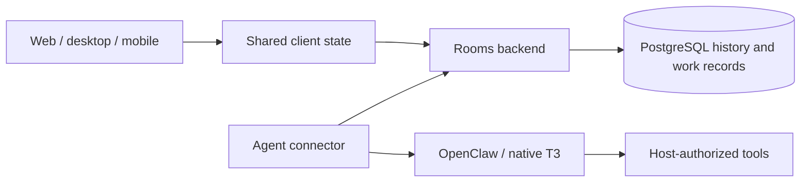

# Threadspace ownership and contracts

Threadspace is one product. Its [product direction](../product/threadspace.md)
defines the useful workspace; [roadmap #26](https://github.com/benwilliams0540/t3code/issues/26)
records delivery and acceptance. Rooms is the product's durable backend. The
existing T3 coding runtime remains an execution path within Threadspace.

## Dependency direction

The backend authorizes and records shared commands. The connector consumes that
work and adapts it to a runtime. UI never decides which runtime session owns a
conversation. Runtime execution never becomes a second source of room membership
or shared history.

## Module ownership

| Module                | Implementation location                               | Owns                                                                                                                                                 |
| --------------------- | ----------------------------------------------------- | ---------------------------------------------------------------------------------------------------------------------------------------------------- |
| Presentation          | `apps/web`, `apps/desktop`, `apps/mobile`             | Layout, drafts, navigation, platform app visibility and notification presentation.                                                                   |
| Shared client state   | `packages/client-runtime/src/rooms`                   | Connection identity and generations, selected-source/room state, reconciliation, change waits, feed traversal and conversation projections/commands. |
| Human transports      | Web/mobile Rooms clients                              | Wire validation, authenticated HTTP, local bridge, server-origin credential and platform storage adapters.                                           |
| Rooms domain          | Separate `t3rooms/ledger` Rails backend               | Membership and authorization; room/channel/conversation identity; history, bindings, ordered turns and atomic result/outbox records.                 |
| Agent contract/client | `packages/rooms-agent-api` and connector wire clients | Validated versioned requests/responses consumed by connectors.                                                                                       |
| Agent connector       | `packages/rooms-agent-connector`                      | Runtime session initialization, actual acceptance receipts, delivery and reconciliation.                                                             |
| Connector host        | `packages/rooms-agent-connector-host`                 | Configuration, credentials from the intended local files, process supervision and transport setup.                                                   |
| Coding runtime        | `apps/server` and its provider adapters               | Existing T3 environment/project/thread orchestration and local provider execution. See [coding runtime architecture](overview.md).                   |

Shared client modules have no React, Electron, native navigation or OpenClaw
Gateway imports. Platform adapters supply the things that actually vary. Change
organization where it improves ownership; keep current consumers working, then
remove replaced decisions and obsolete interfaces. A forwarding facade with
unchanged callers is not a completed extraction.

## Conversation, binding and turn

A **conversation** is durable shared work scoped to a room and channel. An
**execution binding** associates it with an agent, host and actual runtime
session. An **invocation** is one turn with its own delivery identity and order.
Several invocations use the same binding; another conversation gets a distinct
binding. The [glossary](../reference/encyclopedia.md#rooms-workspace) defines these
terms without exposing runtime IDs as frontend navigation IDs.

The backend reserves the binding before the connector initializes the runtime.
OpenClaw initialization creates or resolves the predetermined session key and
returns its real session ID. The backend commits that receipt before dispatch.
Continuation resolves that exact key and ID. A missing or replaced session is
visible and blocks execution; it does not silently create a replacement.

OpenClaw targets carry actual host/agent/session references. Native T3 targets
carry actual environment/project/thread identifiers. They are discriminated
variants, never substitutes for each other. Personal runtime history is not
implicitly imported into shared conversations.

The backend grants dispatch for only the first unfinished turn on a binding.
Later turns remain queued. Dispatch permission is consumed once. A lost dispatch
or acceptance response leaves uncertain state to reconcile rather than issuing
another side-effecting request. Accepted turns retain their actual run ID across
connector restart. Terminal result, attributed reply, receipt and outbox commit
atomically using the existing result path; replay retains the same identity.
Cancellation affects the turn and keeps its conversation/history.

For exact routes, schemas, compatibility fixtures and storage behavior, read the
[backend conversation contract](https://github.com/benwilliams0540/t3rooms/blob/main/docs/design/persistent-room-conversations.md).
Backend implementation details have one owner there; this document describes the
cross-product interface and responsibilities.

## Client lifecycle

Connection snapshots are scoped to source, server and authenticated identity.
Changing those identities invalidates pending discovery, reads and change waits.
A stale success or rejection cannot replace the current workspace or stop its
newer lifecycle. Local/Shared preferences and selected-room state stay explicit;
credentials remain scoped to the exact server origin.

`changeLoop.ts` owns serialized waits, cancellation generations, bounded retry,
catch-up and committed cursors. Web/mobile supply transport and persistence
adapters. Mobile reconciliation records notifications and acknowledgements and
commits its cursor before the next wait advertises realtime availability.
`feedSnapshot.ts` owns pinned forward pagination, sparse global cursors and
durable-item deduplication. Initial loading stays lazy; refresh can traverse the
whole snapshot. A failed partial refresh retains old rows and offers a fresh
snapshot Retry.

Conversation selection and projections consume backend records. Start/send
commands use stable request IDs and preserve a failed draft for deliberate
retry. AppState, secure storage and notification effects stay in native adapters;
layout and accessible loading/error states stay in the UI.

## Compatibility and acceptance

Live v1 auth, ordinary messages, native one-shot invocations and their history
remain supported while their consumers exist. New conversation work uses v2
contracts. Historical isolated invocations have no invented conversation or
session binding. Old readers receive explicit unsupported/unknown-schema
behavior; they never execute a conversation message as a new isolated turn.

Keep focused proof at the consumed interfaces: authorization and atomic writes
in Rails/PostgreSQL; identity/reconnect and pagination through shared client
owners; runtime receipts/recovery through the real connector adapter. Cross-repo
fixtures must decode in actual clients. Use disposable data and deterministic
receipts for source checks.

Source/build proof is distinct from a running designated host, installed native
clients and two-person acceptance. The roadmap records those remaining gates,
including actual host tool/approval behavior. File/diff access, host takeover,
replication and laptop packaging retain their own issue scopes.
